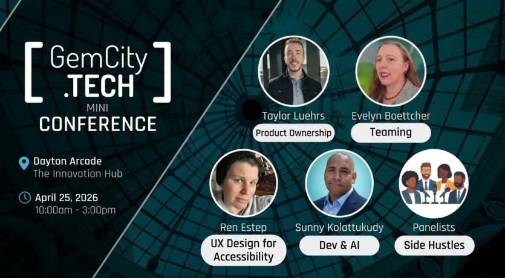



### Mini Conferences

* 🎯 **Product Ownership**  Taylor Luehrs, PMP
  * What the Customer Actually Meant: Product Ownership and Translating Requirements Into Real Software
* 👥 **Teaming**: Evelyn J. Boettcher
  * Resolving the I in Team,  
* Lunch provided by Astero Engineering
* 🎨 **UX & Accessibility**  Ren Estep
  * Don't Get Stuck in a Toxic Situationship:
Building Web Experiences for Every Context  
* ⚙️ **DevOps**  Sunny Kolattukody
  * Dry in the Age of AI
* 💡 **Side Hustles**  
  * Turning your tech skills into additional opportunities and passion projects.

## Events
### [Game Night](https://www.meetup.com/gem-city-tech/events/312652711): Feb 25th, 2026
### [Mini Conference](https://www.meetup.com/gem-city-tech/events/312652762): April 25th, 2026
### [Summer Picnic](https://www.meetup.com/gem-city-tech/events/312652809/?slug=gem-city-tech&eventId=312652809): July 25th, 2026
### [Holiday Potlock](https://www.meetup.com/gem-city-tech/events/312652850/): Dec. 3rd, 2026