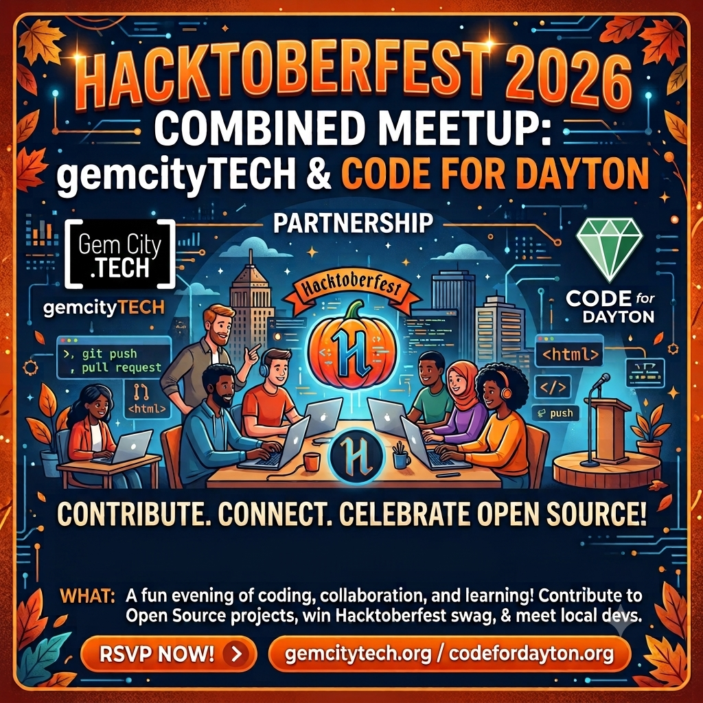

## Mission Brief

```bash
com·mu·ni·ty
2. a feeling of fellowship with others, as a result of sharing common attitudes, interests, and goals.
```



## Save the Date



### [Hacktoberfest](https://hacktoberfest.com/fests/?q=dayton&fest=01a04aa9-ad04-25f3-0814-96d13c4602a8): Oct. 6th, 2026
### [Holiday Potlock](https://www.meetup.com/gem-city-tech/events/312652850/): Dec. 3rd, 2026


## What changed in 2026?

- Leadership:
  * Hanen Alkhafaji: President
  * Evelyn J. Boettcher: Vice President


## Our family of user groups:

All user groups are free and open to the public. 



### Meeting Location

Currently, almost meetings are at the Innovation Hub at the Downtown Dayton Arcade Building.
Exception

* Summer picnic.  The picnic is held at a local park.
* Winter Game night. Local bar

#### The Innovation Hub
31 South Main Street Dayton, OH

## Connect With Us

[](https://www.meetup.com/gem-city-tech) <span style="font-size: xxx-large;">|</span>
  [](https://discord.gg/tseSTARJas) <span style="font-size: xxx-large;">|</span> 
  [](https://www.linkedin.com/company/gemcitytech)
